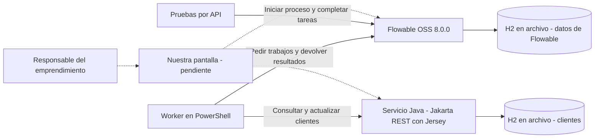

# Cómo conecté las partes

Dejé este dibujo para mostrar cómo está funcionando la prueba local. Las líneas punteadas son las conexiones que faltan desde nuestra pantalla.

## Cómo funciona

Flowable lleva el orden de los pasos del proceso. Cuando llega a una tarea automática, el worker la toma y le pide al servicio Java que consulte o actualice al cliente. Después devuelve el resultado a Flowable para que pueda seguir.

Java guarda los clientes en su base. Flowable guarda aparte las tareas, las variables y el historial de cada proceso.

Como todavía falta nuestra pantalla, completé las tareas de usuario enviando las peticiones directamente a la API de Flowable.

## Dónde quedó cada parte en local

| Parte | Dirección o archivo |
|---|---|
| Flowable 8 | `http://127.0.0.1:8098/flowable-rest` |
| Servicio Java | `http://127.0.0.1:8096/api/leads` |
| Worker | `Flowable/Entrega-2/worker.ps1` |
| Datos de Flowable | `.local/datos-motor/flowable.mv.db` |
| Datos de los clientes | `.local/datos-negocio/clientes.mv.db` |

Para estas pruebas usé H2 guardando los datos en archivos. Nos falta definir qué base de datos vamos a usar. Las claves y la configuración de cada computador quedan en `.local`, que está excluida del repo.

WhatsApp e Instagram se anotan como canal de origen de la consulta; todavía no conecté sus APIs.
