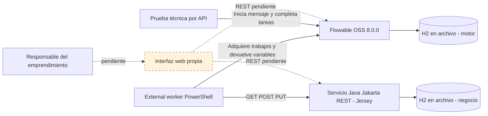

# Arquitectura de la solución

El dibujo representa lo implementado y lo que aún falta conectar. La interfaz propia aparece con borde discontinuo porque sigue pendiente.

## Comunicaciones comprobadas

Flowable coordina el proceso. El worker adquiere sus trabajos externos, invoca las operaciones Jakarta y devuelve variables que permiten seguir el flujo. El servicio usa JPA para leer y escribir los clientes. El motor mantiene por separado instancias, tareas, variables e historial.

El responsable se asigna a las tareas de usuario. Durante la prueba técnica se completaron por API. Este mecanismo de prueba no sustituye la interfaz propia de la aplicación.

## Despliegue local

| Componente | Dirección o ubicación |
|---|---|
| Flowable OSS | 127.0.0.1:8098/flowable-rest |
| Servicio Jakarta | 127.0.0.1:8096/api/leads |
| Worker | Proceso local PowerShell, sin puerto de entrada |
| Base del motor | .local/datos-motor/flowable.mv.db |
| Base de negocio | .local/datos-negocio/clientes.mv.db |

El arranque integrado usa dos bases relacionales H2 persistentes. El grupo puede optar por PostgreSQL, MySQL u otra alternativa compatible y volver a verificar el almacenamiento. Las contraseñas se generan por entorno y quedan en archivos locales excluidos del repo.

No hay integración con APIs de WhatsApp o Instagram. Esos nombres identifican el canal de origen que se registra en la consulta. No se publicaron los servicios en Internet.
