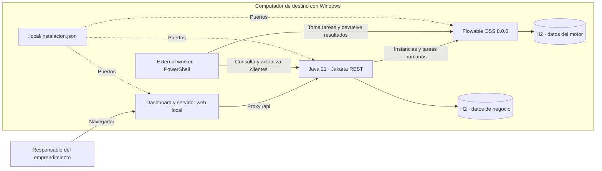

# Arquitectura de Peluditos Pet Chile

El destino definido es un computador Windows de 64 bits. El navegador abre el servidor web local, que entrega el dashboard y reenvía las llamadas a Java. Java inicia los BPMN y gestiona las tareas humanas con Flowable. El worker toma las tareas externas, consulta o actualiza el contacto en Java y devuelve el resultado a Flowable.

## Configuración y almacenamiento

| Componente | Puerto de ejemplo | Datos o configuración |
| --- | ---: | --- |
| Dashboard | 5173 | El navegador usa la ruta /api del servidor web. |
| Java 21 | 8096 | H2, contactos y consultas en .local/datos-negocio/clientes.mv.db. |
| Flowable OSS 8.0.0 | 8098 | H2, instancias y tareas en .local/datos-motor/flowable.mv.db. |
| Worker | | Se conecta a Java y Flowable con las direcciones de la instalación. |

Los tres puertos se definen en un solo archivo de configuración. El paquete genera las credenciales en la carpeta privada de la instalación. Para reinstalar o respaldar, sigue la [guía de Windows](../PeluditosPetChile_APP/README.md). La [fuente editable del diagrama](modelo-arquitectura.mmd) está en esta carpeta.
