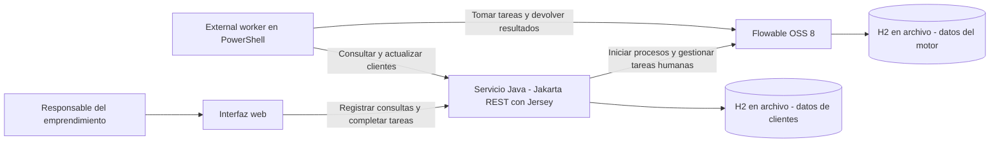

# Arquitectura local

La pantalla envía las consultas a Java. Java inicia el proceso en Flowable y se comunica con el motor para listar y completar tareas humanas. El worker toma las tareas externas, consulta o actualiza el cliente en Java y devuelve el resultado a Flowable.

Java guarda los datos de clientes. Flowable guarda aparte las tareas, las variables y el historial de cada proceso. La configuración para el entorno de destino queda pendiente.

## Dónde quedó cada parte en local

| Parte | Dirección o archivo |
|---|---|
| Flowable 8 | `http://127.0.0.1:8098/flowable-rest` |
| Servicio Java | `http://127.0.0.1:8096/api/leads` |
| Worker | `External-Workers/worker.ps1` |
| Datos de Flowable | `.local/datos-motor/flowable.mv.db` |
| Datos de los clientes | `.local/datos-negocio/clientes.mv.db` |

Para estas pruebas usé H2 guardando los datos en archivos. Nos falta definir qué base de datos vamos a usar. Las claves y la configuración de cada computador quedan en `.local`, que está excluida del repo.

WhatsApp e Instagram se anotan como canal de origen de la consulta; todavía no conecté sus APIs.
